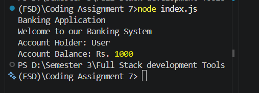

# Banking Application

## Project Description
This is a beginner-level JavaScript project created to demonstrate basic banking application information using Node.js.

## Motivation
The purpose of this project is to learn JavaScript, run a Node.js program, and understand basic project structure.

## Installation Guidelines
1. Install Node.js.
2. Open the project folder in Visual Studio Code.
3. Open the terminal in the project folder.
4. Run the following command:

   ```bash
   node index.js
   ```

5. Check the output in the terminal.

## Screenshots

The application output screenshot demonstrates the JavaScript program running in the terminal.


## Technologies Used
- JavaScript
- Node.js
- Visual Studio Code

## Features

### Current Features
- Displays the banking application title.
- Displays a sample account holder name.
- Displays a sample account balance.

### Future Improvements
- Add account creation.
- Add deposit and withdrawal functionality.
- Add account balance updates.

## License
MIT License
